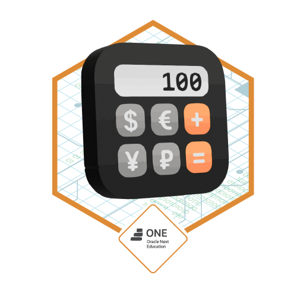

# Conversor de Moedas



> Projeto desenvolvido como solução para o Desafio de Programação Orientada a Objetos e Consumo de API do programa **Oracle Next Education (ONE) / Alura**.

---

## Descrição do Projeto

O **Conversor de Moedas** é uma aplicação de linha de comando desenvolvida em **Java** que realiza conversões de câmbio em tempo real. Os dados são obtidos diretamente da [ExchangeRate-API](https://www.exchangerate-api.com/), garantindo taxas atualizadas entre diversas moedas internacionais.

---

## Funcionalidades

- **Conversões Pré-definidas:**
  - Dólar Americano (USD) ⇄ Real Brasileiro (BRL)
  - Euro (EUR) ⇄ Real Brasileiro (BRL)
  - Peso Argentino (ARS) ⇄ Real Brasileiro (BRL)
- **Conversão Personalizada:** Permite converter entre quaisquer moedas válidas informando os códigos ISO (ex: `GBP`, `JPY`, `CAD`, `CHF`).
- **Histórico de Conversões:** Exibe todas as conversões realizadas durante a execução com data, hora e taxa aplicada.
- **Validação de Entrada:** Tratamento para números inválidos, moedas inexistentes e cancelamento de operações a qualquer momento.

---

## Tecnologias Utilizadas

- **Java 17+** (com `java.net.http.HttpClient` e `Records`)
- **Gson 2.11.0** (para manipulação e desserialização de JSON)
- **Apache Maven** (gerenciamento de dependências e build)
- **ExchangeRate-API** (serviço web de taxas de câmbio)

---

## Configuração da Chave de API

Para realizar as conversões, é necessário possuir uma chave gratuita da **ExchangeRate-API**:

1. Acesse [ExchangeRate-API](https://www.exchangerate-api.com/) e obtenha uma chave gratuita com seu e-mail.
2. Defina a chave na variável de ambiente `EXCHANGE_API_KEY`:

### Windows (PowerShell):
```powershell
$env:EXCHANGE_API_KEY = "sua_chave_aqui"
```

### Windows (CMD):
```cmd
set EXCHANGE_API_KEY=sua_chave_aqui
```

### Linux / macOS:
```bash
export EXCHANGE_API_KEY="sua_chave_aqui"
```

*(No **IntelliJ IDEA**, adicione a variável `EXCHANGE_API_KEY` em **Run** > **Edit Configurations...** > **Environment variables**).*

---

## Como Executar o Projeto

### Pré-requisitos
- **Java JDK 17** ou superior instalado
- **Maven 3.8+** (opcional se executar via IDE)

### Execução via Terminal

1. **Clone o repositório:**
   ```bash
   git clone https://github.com/seu-usuario/conversor-de-moedas.git
   cd ConversorDeMoedas
   ```

2. **Configure a variável de ambiente:**
   ```powershell
   $env:EXCHANGE_API_KEY = "sua_chave_aqui"
   ```

3. **Compile o projeto:**
   ```bash
   mvn clean compile
   ```

4. **Inicie a aplicação:**
   ```bash
   mvn exec:java
   ```

---

## Exemplo de Uso

Ao iniciar a aplicação, o menu interativo é exibido:

```text
===============================================================
           BEM-VINDO AO CONVERSOR DE MOEDAS (ALURA / ONE)      
===============================================================
---------------------------------------------------------------
 1) Dólar (USD)          => Real Brasileiro (BRL)
 2) Real Brasileiro (BRL)=> Dólar (USD)
 3) Euro (EUR)           => Real Brasileiro (BRL)
 4) Real Brasileiro (BRL)=> Euro (EUR)
 5) Peso Argentino (ARS) => Real Brasileiro (BRL)
 6) Real Brasileiro (BRL)=> Peso Argentino (ARS)
 7) Conversão personalizada (informe as moedas)
 8) Exibir histórico de conversões da sessão
 9) Sair
---------------------------------------------------------------
Escolha uma opção válida [1-9]: 
```

Basta selecionar a opção desejada, informar o valor a ser convertido e conferir o resultado em tempo real.

---

## Autor

Desenvolvido por **Carlos** durante a formação **Oracle Next Education (ONE) / Alura**.
